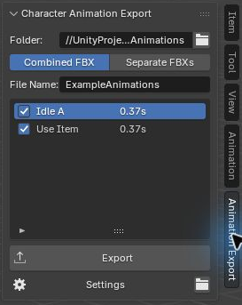

# Character Animation Export

**Folder → Combined FBX → Check clips → Export.**

Export Blender character animations into Unity, including facial and animated prop motion. NLA strips supply the clip ranges automatically.

## Install

Download and extract **CharacterAnimationExport-Prototype-0.3.0.zip** from [Releases](https://github.com/Uncleared/character-animation-export/releases).

- **Blender:** Preferences → Add-ons → Install from Disk. Install the inner **CharacterAnimationExport-0.3.0.zip** and enable it.
- **Unity:** Assets → Import Package → Custom Package. Install **CharacterAnimationExport-Unity-0.3.0.unitypackage**.

**Update both packages together.** Blender 5.0 and 5.2 are supported for combined export.

## Export one combined FBX

1. In Blender’s 3D View, press **N → Animation Export**.
2. Pick your **Folder** inside the Unity project’s **Assets** folder.
3. Choose **Combined FBX**, set **File Name** once, check the clips, and press **Export**.

Save the blend to remember your choices. After that, just press **Export**. Add, move or resize NLA strips normally; no manual start/end ranges or Unity clip cutting. Body, facial animation and props share one FBX with geometry included once.

Unchecking or removing a clip asks once before removing it from the combined FBX. Surviving clips keep their references and events; rechecking the same clip restores its saved events/settings. Deliberately removed clips need their game references updated.

To use an alternate take **without changing a published clip’s identity**, uncheck the alternate, open **Settings**, and use the original clip’s **link button → Replace Source**. Renaming a source strip also keeps its published identity.

**Separate FBXs:** choose this option to export one file per checked clip. Unchecking leaves its existing file in place. Changing layout, Folder or File Name creates separate outputs; update game references when switching.

## Unity setup, once per character

Select the export folder → **Assets → Animation Import Settings**. Choose **Generic**, or **Humanoid** and its matching **Source Avatar**.

Future exports import automatically with **Bake Rotation/Y/XZ**, **full prop masks**, **Original Facing** and **Original XZ Origin** enabled by default. Native custom masks and per-clip overrides are preserved. Use the imported clips in your existing animation system.

## Events

Continue using Unity’s native **FBX → Animations → Events**. Updates preserve event seconds and payloads. Shortening past an event warns and retains its previous data for correction. Moving a whole strip does not shift its local event times; retiming the gesture itself may require reviewing its cues.

The optional **AnimationEventEditor-0.3.0.unitypackage** provides **Tools → Animation Event Editor**, independently of this exporter. Its preview supports pan, orbit, zoom and frame stepping. [Preview controls](docs/EVENTS.md).

## When experimenting

- **Save As:** use **Keep Existing Outputs** to continue, or **New Character Export** for a different character. These buttons appear when needed.
- **Layered tracks:** overlaps are baked as authored and reported; mute an alternate track if you do not want it included. Push Down or unlink an active rig action before NLA export.
- **Props outside the rig:** choose their collection under **Settings → Objects and Props**.
- **Handing files over:** copy the whole output folder. Its automatic support data stays beside the FBX; there is no JSON workflow to manage.
- **Cancel or export failure:** previous files and Unity metadata are preserved.

[Verification and limits](docs/VALIDATION.md) · [Maintenance](docs/MAINTAINING.md) · [Changelog](CHANGELOG.md) · [Report a bug](https://github.com/Uncleared/character-animation-export/issues/new/choose)

Existing 0.1 libraries remain under **Tools → Legacy → Character Animation Library**. [Legacy guide](docs/LEGACY-0.1.md).

The screenshot uses the supplied generated example. Both Unity tools are Editor-only. No open-source license has been selected.
