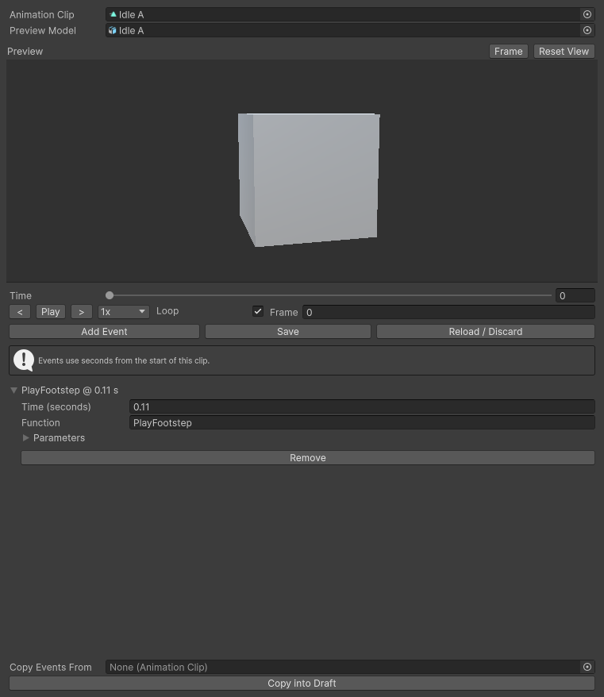

# Optional event editor

Install **AnimationEventEditor-0.4.1.unitypackage**, then open **Tools → Animation Event Editor**. Choose a `.anim` or an imported FBX clip, edit events and press **Save**. It works without the exporter or its support data. Unity’s native event tools remain available.

| Preview action | Control |
| --- | --- |
| Pan | Left or middle drag |
| Orbit | Right drag or Alt-left drag |
| Zoom | Scroll or Alt-right drag |
| Frame current pose | F |
| Reset view | Home |
| More preview space | Drag the divider |

Use frame stepping, frame number, speed and looping to place cues. Previewing does not fire events. Save and Discard are explicit; a stale draft cannot overwrite newer native edits.

Drag the full character prefab into **Preview Model**, especially for Lightweight animation FBXs. Your choice stays selected when changing clips, discarding a draft or reloading the window.
